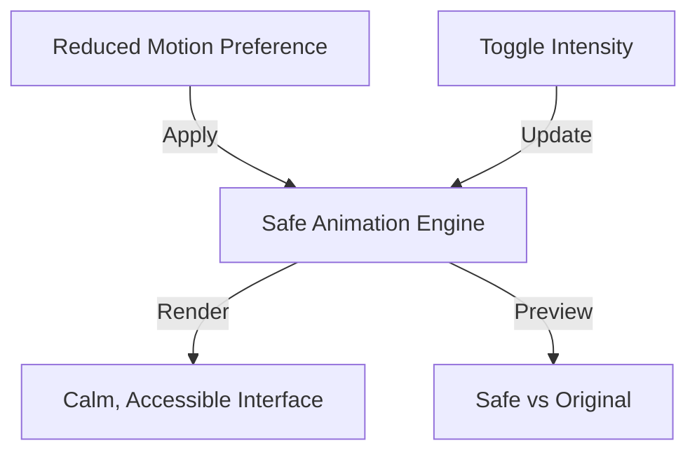

# wax-seizure-safe-animations — Seizure-Safe Animation Alternatives & Accessibility Suite

> **Status:** 🔒 Private (In Development) | Target Public Release: August 2026  
> **Category:** Accessibility & Inclusive Design  
> **Parent Catalog:** [pixel-journey/wax-ecosystem-blueprint-catalog](https://github.com/pixel-journey/wax-ecosystem-blueprint-catalog)

**One-sentence goal:** A comprehensive suite of seizure-safe animation alternatives, toggles, and replacements that eliminate risky motion patterns (flashing, rapid changes, parallax) while preserving delightful, engaging UX for all users on WAX.

---

## 1. Overview & Goal

This blueprint makes Web3 interfaces safe and inclusive by design. It replaces potentially harmful animations with calm, beautiful alternatives that everyone can enjoy.

- **Why it matters for WAX:** Accessibility is non-negotiable. Seizure-safe design protects vulnerable users and demonstrates genuine care for the community.
- **Public infrastructure only:** Client-side animation libraries with safe fallbacks, user preference detection. No custom contracts.
- **Target users:** All users, especially those with photosensitivity or epilepsy, accessibility-conscious projects, inclusive designers.
- **Success metrics:** "All animations are safe by default or easily toggled", "Beautiful calm alternatives that feel premium", "Zero risky motion patterns in the interface".

---

## 2. Concepts & Inspiration

- **Core concepts:** Identify risky patterns (rapid flashing, spinning, intense parallax). Provide safe alternatives (gentle fades, static states, reduced intensity). Respect user preferences via prefers-reduced-motion and explicit toggles.
- **Pain points:** Many Web3 interfaces use flashy animations that can trigger seizures. Users have no easy way to opt out.
- **Inspirations:** WCAG seizure-safe guidelines, modern accessibility toolkits, calm design systems. Web3: safe-by-default with beautiful alternatives.
- **Cross-references:** Perfect with other accessibility blueprints (reduced-motion dashboard, haptic feedback, cognitive-load simplified tx, screen-reader inventory). Complements all interactive and gaming tools.

---

## 3. Design Specifications (Pixel Journey Standards)

### 3.1 Visual & Interaction Design
- Clean, calm aesthetic with gentle transitions as default.
- Main view: Animation examples with safe/unsafe comparison and toggle.
- Controls: Global reduced-motion toggle, per-animation intensity sliders, preview modes.
- Micro-interactions: Subtle, safe animations that feel premium without risk.
- Responsive: Full suite on desktop; simplified mobile controls.

### 3.2 Key Views / Components
- `SeizureSafeSuite.tsx` — Main accessibility suite interface.
- `AnimationToggle.tsx` — Elegant toggle for safe vs original animations.
- `SafeAlternatives.tsx` — Gallery of calm replacement animations.
- `PreferencePanel.tsx` — User settings for motion sensitivity.
- `PreviewModal.tsx` — Side-by-side comparison of risky vs safe versions.

### 3.3 Accessibility (A11y) & Inclusive Design
- WCAG 2.2 AA: Full keyboard support, screen reader announcements, high contrast.
- Strong respect for prefers-reduced-motion media query.
- Clear explanations of why certain animations are replaced.

### 3.4 Performance & Optimization Targets
- Lightweight animation library with safe fallbacks.
- Instant toggle between modes.
- No performance penalty for safe alternatives.

---

## 4. Technical Architecture

### 4.1 Core Tech Stack
- Next.js 15 + TypeScript + Tailwind + shadcn/ui + framer-motion (with safe configs)
- prefers-reduced-motion detection
- Simple animation mapping system (risky → safe)
- User preference persistence

### 4.2 Data Flow Diagram


### 4.3 Folder Structure
```
app/
├── components/
│   ├── safe/
│   │   ├── SeizureSafeSuite.tsx
│   │   └── AnimationToggle.tsx
│   └── preview/
│       └── PreviewModal.tsx
├── hooks/useSeizureSafe.ts
├── lib/
│   ├── animation/
│   │   └── safe-mapper.ts
│   └── accessibility/
│       └── preference-manager.ts
└── types/accessibility.ts
```

### 4.4 Security & Privacy
- Purely client-side. User preferences stored locally.

---

## 5. Implementation Examples & Code Snippets

**Core safe animation hook**
```ts
// hooks/useSeizureSafe.ts
export function useSeizureSafe() {
  const prefersReduced = useReducedMotion();
  const [intensity, setIntensity] = useState(1);

  const getAnimationConfig = (riskyConfig: any) => {
    if (prefersReduced || intensity === 0) return safeConfig;
    return { ...riskyConfig, intensity };
  };

  return { getAnimationConfig, setIntensity };
}
```

**Safe animation example**
```ts
const safeFade = { opacity: [0, 1], transition: { duration: 0.4, ease: 'easeOut' } };
```

---

## 6. Demo & Testing
- Demo mode with risky vs safe animation comparisons.
- Interaction tests: toggles, intensity sliders, preview.
- Accessibility tests with reduced-motion preference simulation.
- Edge cases for extreme sensitivity settings.

---

## 7. Roadmap
Phases: Safe animation mapping engine → Suite UI with toggles and previews → Polish, a11y, documentation → full documentation.

Future: Community-contributed safe animation library, integration with all other components.

---

## 8. Visual References
> Clean, calm accessibility tools with beautiful safe alternatives. Clear comparison views, intuitive controls. Reference: high-quality accessibility design systems and calm UI toolkits.

---

## 9. Related Blueprints
- `wax-reduced-motion-dashboard`, `wax-haptic-feedback-simulator`, `wax-cognitive-load-simplified-tx` — Full accessibility suite.
- All interactive and gaming blueprints.

---

## 10. License & Credits
MIT. Built for truly inclusive and safe Web3 experiences on WAX.

**Pixel Journey — Beautiful interfaces for public blockchain data.**
